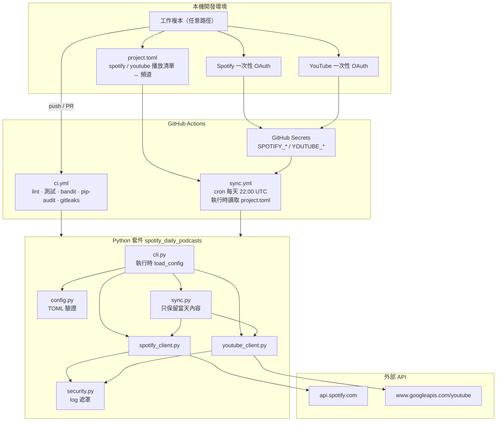
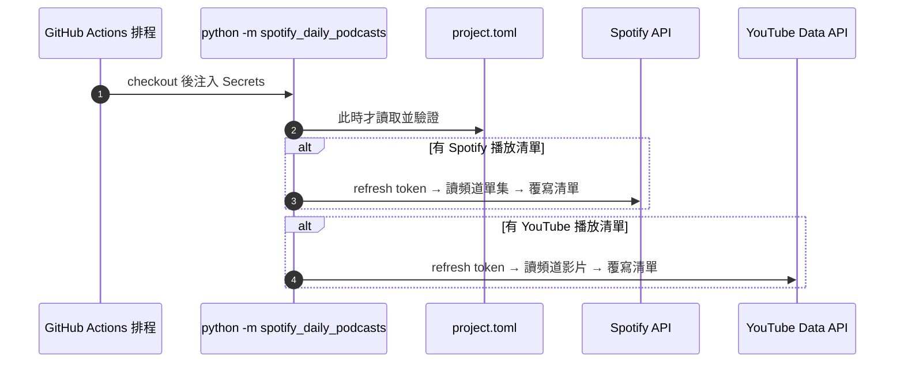
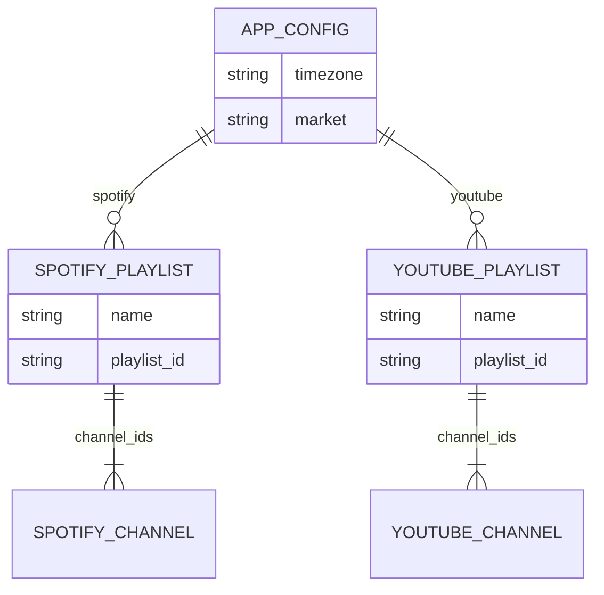
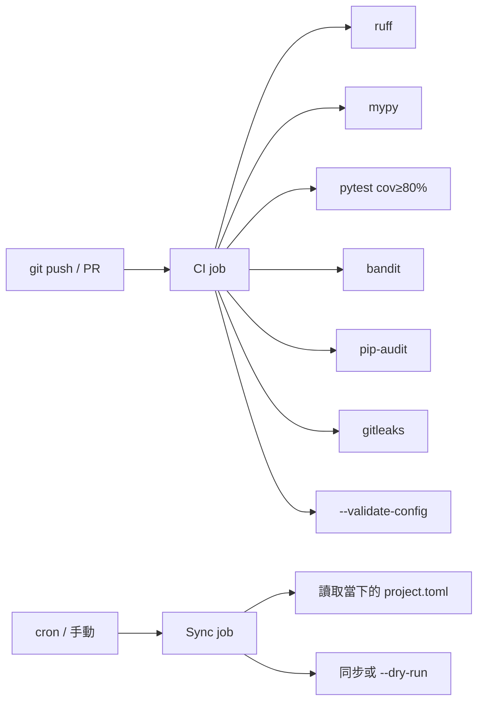
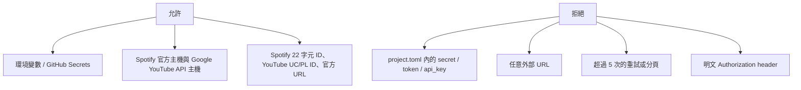

# NewDailySpotifyPodcastList 系統架構

本專案沒有常駐伺服器。排程與執行都在 **GitHub Actions**；Python 程式只在 CI 或本機一次性跑完即結束。

工作目錄可以是任何本機路徑，不要寫死某一台開發機的絕對路徑。

播放清單與頻道定義在根目錄 `project.toml`，**只在排程 / CLI 執行時讀取**。

## 1. 部署與執行環境

## 2. 每日同步資料流

## 3. 設定模型

同一份 `project.toml` 可同時宣告兩個平台；平台之間互不共用清單內容。至少需要一個播放清單。

## 4. CI/CD

Dependabot 每週掃描 `pip` 與 `github-actions` 依賴。

## 5. 資安邊界

OAuth 授權碼流程僅允許 redirect 到 `http://127.0.0.1`，在本機完成後把 refresh token 存進 GitHub Secrets。
